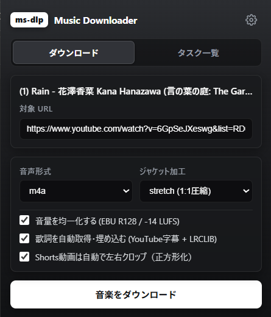
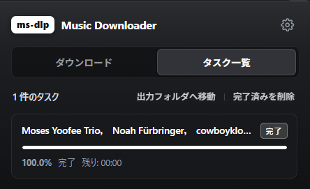
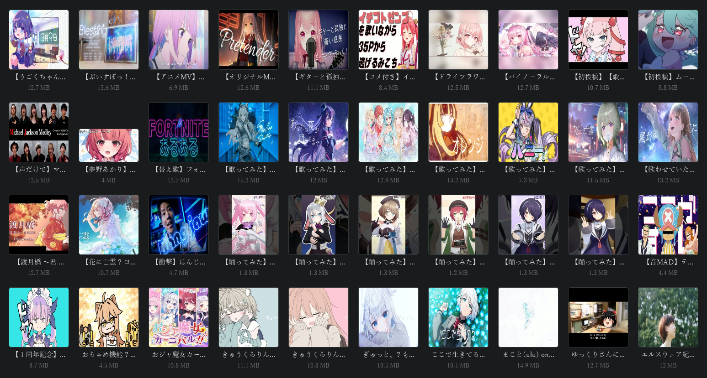
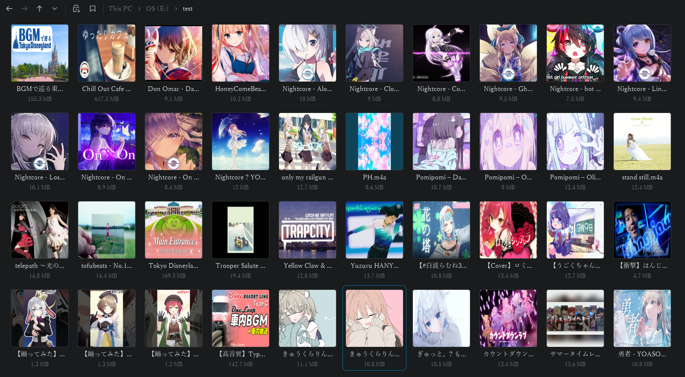

# ms-dlp

YouTubeなどから音源をダウンロードし、正方形ジャケット画像、メタデータおよび歌詞を自動埋め込みする音楽特化ダウンローダー（Rust製ネイティブコア / yt-dlp, ffmpegを使用しています）

PCならFoobar2000、スマホであればApple Music、Spotifyなどのサービスにアップロードし、歌ってみた動画などをどこでも聞けるようになります。（その際、サービスよっては有効形式が異なるので注意して下さい。下記）

ブラウザ拡張機能 と CUI の2つのインターフェースに対応しています。

<p align="center">
  


</p>

<p align="center">
  
</p>

<p align="center">
  
</p>

---

## 主な特徴

- **Rustネイティブ高速動作**: 単一のネイティブバイナリ（`ms-dlp.exe`）により起動オーバーヘッドをミリ秒単位に極小化
- **5並列分割ダウンロード**: 長尺動画も高速安定保存
- **EBU R128 音量自動均一化**: 国際規格（-14 LUFS / True Peak -1.0 dBTP）の2パス解析により、音質劣化・音割れなく曲ごとの音量差を自動解消
- **オリジナルメタデータの保持**: 取得先のタイトルおよびアーティスト情報（投稿者/チャンネル名）を加工せずタグ・ファイル名に忠実に反映、保存します
- **二段階ハイブリッド歌詞埋め込み**:
  1. YouTubeの公式字幕（日本語優先）から歌詞を自動抽出・整形
  2. 字幕がない場合、オンライン歌詞データベース（LRCLIB）を自動検索
- **正方形ジャケット処理 & 救出システム**:
  - **既に1:1サムネイルの場合**: トリミングや再エンコードを一切行わず、そのまま埋め込み
  - **16:9等の非正方形サムネイル**: 設定に応じて自動加工（1:1圧縮 `stretch` / 左右切り落とし `crop` / ぼかし背景敷き `blur` / 無加工 `original`）
  - **多段サムネイル救出**: 取得漏れ時もYouTube CDN直接ダウンロード（0.1秒）やクライアント切り替えリトライで確実にジャケットを確保
- **プレイリスト誤爆防止**: YouTubeのMix・ラジオ再生リスト（`list=RD...` / `list=UL...`）等のパラメータを自動検出・無効化し、再生中の単曲のみを保存
- **2つの利用スタイル**:
  1. **ブラウザ拡張機能**: ブラウザツールバーからワンクリックで完全バックグラウンド保存。リアルタイム進捗バー・タスク管理・ワンクリック出力フォルダ移動に対応
  2. **CUI（`ms-dlp.exe` / `download_music.bat`）**: ターミナルからURLを入力してダウンロード
- **設定変更**: 出力音声形式（M4A/MP3/FLAC/Opus等）、音量均一化のON/OFF、ジャケット加工モード、歌詞埋め込みのON/OFFを設定
- **Cookie対応**: `private/` フォルダ内の `cookies.txt` を自動認識し、年齢制限動画等にも対応

---

## フォルダ構成

```text
ms-dlp/
├── ms-dlp.exe                <- メイン実行ファイル (Rust製ネイティブバイナリ)
├── download_music.bat        <- CUI起動用バッチ (ダブルクリックで実行)
├── Cargo.toml / Cargo.lock   <- Rustプロジェクト定義
├── src/                      <- Rustソースコード
├── config.json               <- カスタマイズ設定ファイル
├── README.md                 <- 本ドキュメント
├── .gitignore                <- Git除外設定
├── msdlp-extension/          <- ブラウザ拡張機能 (Chrome / Edge / Brave 等)
│   ├── manifest.json         <- 拡張機能定義 (Manifest V3)
│   ├── popup.html/.js/.css   <- ポップアップ操作・タスク進捗管理UI
│   ├── options.html/.js/.css <- ダウンロード環境設定画面 (Options)
│   ├── background.js         <- サービスワーカー (Native Messaging通信)
│   ├── assets/               <- UIスクリーンショット画像等
│   └── icons/                <- アイコン画像
├── native_host/              <- ネイティブメッセージングホスト設定
│   ├── host_launcher.bat     <- ブラウザ連携ランチャー (ms-dlp.exeを呼び出し)
│   ├── install_host.bat      <- レジストリ登録バッチ (初回1回のみ実行)
│   ├── uninstall_host.bat    <- レジストリ登録解除バッチ
│   └── tasks/                <- タスク状態 JSON 一時格納ディレクトリ
├── bin/                      <- 外部ツール配置フォルダ
│   ├── yt-dlp.exe
│   ├── ffmpeg.exe
│   ├── ffprobe.exe
│   └── AtomicParsley.exe
├── private/                  <- Cookie等の個人設定 (Git除外)
│   └── cookies.txt (任意配置)
└── output/                   <- 完成した音楽ファイルの保存先
```

---

## 使い方

### 1. ブラウザ拡張機能から保存する

ブラウザの操作だけで裏で音楽をダウンロード・タグ付け保存できます。

#### ⚠️初回セットアップ⚠️

1. `native_host/install_host.bat` をダブルクリックして実行します（Chrome / Edge / Brave 等のレジストリにホストが登録されます）。`native_host/`フォルダ直下に配置されています。
2. ブラウザのアドレスバーに `chrome://extensions`（Edgeは `edge://extensions`）と入力して開きます。
3. 画面右上の「デベロッパー モード」をオンにし、「パッケージ化されていない拡張機能を読み込む」から `ms-dlp/msdlp-extension` フォルダを選択します。

#### 日常の利用

1. YouTube等の動画・音楽ページを開きます。
2. ブラウザツールバーの `ms-dlp` アイコンをクリックします。
3. ポップアップ画面でタイトルとURL、設定（音声形式・ジャケット加工モード・歌詞埋め込み）を確認し、**「音楽をダウンロード」** をクリックします。
4. 「タスク一覧」タブで進行状況バーを確認できます。完了すると `output/` フォルダへ保存されます。
5. タスク一覧右上の **「出力フォルダへ移動」** をクリックすると、保存先フォルダをエクスプローラー等で直接開くことができます。
6. ポップアップ右上の歯車アイコンをクリックすると、デフォルトの音声形式やジャケット加工モードを設定できる **「環境設定 (Options)」** 画面が開きます。

---

### 2. CUI（`ms-dlp.exe` / `download_music.bat`）を使う

1. `ms-dlp.exe` または `download_music.bat` をダブルクリックして実行します（ターミナルから `ms-dlp.exe <URL>` を直接指定して起動することも可能です）。
2. URLを入力して `Enter` を押すと、ダウンロードおよびタグ付けが実行されます（複数のURLをスペース区切りで入力すれば連続処理されます）。
3. 空欄のまま `Enter` を押すと終了します。

---

## 設定ファイル（`config.json`）

`config.json` を編集することで、デフォルトの動作をカスタマイズできます（拡張機能の設定画面で変更した内容も自動的に同期・保存されます）。

```json
{
  "audio_format": "m4a",
  "audio_quality": "0",
  "cover_mode_non_square": "stretch",
  "embed_lyrics": true,
  "concurrent_fragments": 5,
  "output_folder": "output",
  "auto_crop_shorts": true,
  "normalize_audio": true,
  "target_loudness_lufs": -14.0
}
```

- **`audio_format`**: 出力形式（`"m4a"`, `"mp3"`, `"flac"`, `"opus"` 等）
- **`audio_quality`**: 音質設定（`"0"` は最高品質）
- **`normalize_audio`**: EBU R128 音量自動均一化（`true` / `false`）
- **`target_loudness_lufs`**: 目標ラウドネス値（デフォルト: `-14.0` LUFS、Apple Music推奨: `-16.0`）
- **`auto_crop_shorts`**: YouTube Shorts動画の自動正方形クロップ（`true` / `false`）
- **`cover_mode_non_square`**: 元画像が1:1正方形でない場合の処理方式
  - `"stretch"` : （デフォルト）無理やり1:1に圧縮して全体を収める
  - `"crop"`    : 左右を均等に切り落として1:1正方形にする
  - `"blur"`    : 背景にぼかし画像を敷いて正方形にする
  - `"original"`: 横長のまま無加工で埋め込む
- **`embed_lyrics`**: 歌詞の自動取得・埋め込み（`true` / `false`）
- **`concurrent_fragments`**: 並列分割ダウンロード数（デフォルト: `5`）
- **`output_folder`**: 完成ファイルの保存先フォルダ名（相対パス）

---

## 主要サービス別 推奨・対応アップロード形式

ダウンロードした音源ファイルを各音楽ストリーミングサービスやクラウドライブラリへアップロード・同期する際の対応状況です。

| サービス / 用途         |                推奨形式                | 対応形式                        | 備考・注意点                                                           |
| :---------------------- | :------------------------------------: | :------------------------------ | :--------------------------------------------------------------------- |
| **Apple Music**   |           **`m4a`**           | M4A (AAC), MP3, ALAC, WAV, AIFF | **FLAC / Opus は非対応**。最大200MB、2時間まで                   |
| **YouTube Music** | **`m4a`** / **`flac`** | M4A (AAC), MP3, FLAC, OGG, WMA  | **Opus WAV は非対応**。1曲あたり最大300MBまでアップロード可能。 |
| **Spotify**       | **`m4a`** / **`mp3`** | M4A (AAC), MP3, MP4             | **Opus FLAC ALACは非対応**。クラウド保存不可。                   |
| Amazon Music            |                   /                   | 非対応                          | アップロード自体が不可                                                 |

特にこだわりがない場合、 **`m4a`** が最も推奨されます。
